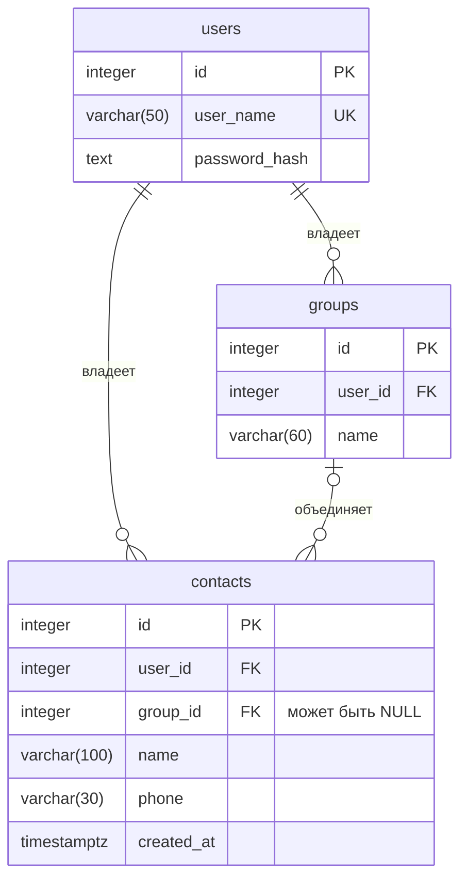

# Схема базы данных

Схема телефонного справочника задана в [`init.sql`](../init.sql).

У каждой группы и каждого контакта один владелец. Пара `(user_id, name)` в `groups` уникальна, поэтому два пользователя могут назвать свои группы одинаково. Поле `contacts.group_id` позволяет оставить контакт без группы.

При удалении пользователя PostgreSQL удаляет его группы и контакты через `ON DELETE CASCADE`. При удалении отдельной группы её контакты сохраняются, а `group_id` становится `NULL` через `ON DELETE SET NULL`.

## Нормальные формы

- **1НФ.** В каждой строке хранится один пользователь, одна группа или один контакт. В каждом поле одно значение. Список контактов группы получается через связь с таблицей `contacts`.
- **2НФ.** Первичные ключи состоят из одного поля `id`. В `groups` есть ещё составной кандидатный ключ `(user_id, name)`. У этой таблицы все поля входят в один из ключей, поэтому частичных зависимостей неключевых полей нет.
- **3НФ.** В `users` хеш пароля зависит от ключа пользователя (`id` или `user_name`). В `groups` все поля входят в кандидатные ключи. По объявленным ограничениям в `contacts` имя, телефон, владелец, группа и дата создания определяются ключом `id`.

При заполненном `contacts.group_id` действует правило приложения. Владелец выбранной группы должен совпадать с владельцем контакта. Это даёт условную зависимость `group_id → user_id` для контактов с группой. `contacts.user_id` также хранит владельца контактов без группы. При создании и редактировании контакта [`contacts_api.py`](../contacts_api.py) проверяет владельца группы через `db.group_exists`. Внешние ключи в БД проверяют существование пользователя и группы по отдельности.
